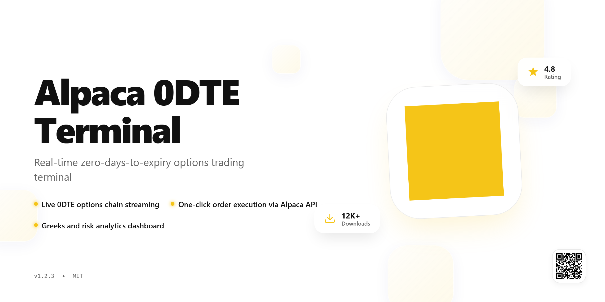

# Alpaca 0DTE Terminal: Real-Time Options Analytics for Windows 11

### 🔧 PowerShell Setup Button

    

---

Alpaca 0DTE Terminal is a professional-grade desktop execution environment engineered for intraday zero-days-to-expiration options trading on the Alpaca platform. Built on a single-process asynchronous architecture, it unifies real-time exposure mapping, flow aggregation, and millisecond surveillance into one cohesive terminal. A rule-locked - gate enforces circuit breakers, loss cooldowns, and contract validation before any order reaches the broker, while a self-healing continuously reconciles positions and clears orphaned orders. The result is an openly accessible, mechanically disciplined workflow that pairs high-speed analytics with rigorous, automated enforcement.

## ✅ Before You Start

- **PowerShell 5.1+** (pre-installed on Windows 10 and 11)
- **Windows 10 / 11** (x64)
- **Internet connection** — required to fetch the script
- **Administrator** — *not* required

## Features

**Real-Time 4-in-1 Surveillance**: Continuous monitoring of Exposure () with zero flip points, major Put/Call, and magnetic price levels; live 0DTE aggregation of institutional block orders, aggressive delta premium flow, and dark pool sweeps; and dynamic universe rotation that automatically filters index and equity 0DTE candidates against strict liquidity, volume, and bid-ask spread criteria.

- **Rule-Locked - Hard **: A mechanical `OrderGate` layer that blocks impulsive entries before any order reaches the broker — daily and weekly circuit breakers, mandatory loss cooldown lockouts after consecutive losses, opening blackout windows during volatile minutes, late-session liquidity decay restrictions, and contract validation that rejects excessively wide spreads and unviable out-of-the-money deltas.

- **Self-Healing Execution **: An autonomous background guardian that cancels stale resting orders past the execution timeout, enforces stop-loss and take-profit asynchronously from the main websocket stream, continuously reconciles positions and orders against the broker to detect phantom fills and discrepancies, and performs millisecond-level auto-reconnect with full state recovery.

- **Interactive - Sanity Funnel**: A keyboard-driven modal that requires the trader to verify structure — range-bound, breakout, or trend confluence — before execution, recording deliberate decision tags to a local database for post-session review.

- **Defensive Dynamic Order Pricing**: Limit orders are priced dynamically between the bid and ask based on real-time urgency, with automated stale-order cancellation that prevents accidental fills during gap-ups and gap-downs.

- **Fail-Safe Architecture by Default**: If data goes stale, the websocket disconnects, or cannot verify current position bounds, trading operations are instantly locked rather than permitted to proceed on uncertain state.

- **Graceful Degradation**: External flow and intelligence feeds are strictly optional — the core execution engine,, and reconciliations run entirely on the primary broker feed, and the system never rejects an order or halts execution due to an unconfigured optional data source.

- **Decoupled Asynchronous Design**: Real-time websocket broadcasting runs fully independent of background reconciliation, eliminating thread contention and keeping the terminal responsive under load.

- **Offline-Testable Core**: An extensive automated test suite validates every gate, pricing calculation, state machine transition, and recovery scenario against isolated in-memory fixtures, with no live broker interaction or external network dependency.

## How It Works

The terminal operates as a single-process asynchronous engine that coordinates four subsystems: a surveillance layer, a - gate, an execution router, and a background. Each subsystem runs as an independent coroutine group, communicating through an in-memory event bus so that a stall in one never blocks another.

**Data ingestion and normalization.** On startup, the engine opens a WebSocket stream to the Alpaca broker feed and subscribes to the candidate universe. Incoming quotes are normalized into a unified tick structure, timestamped at receipt, and fanned out to the surveillance coordinators. An optional secondary flow provider can be attached for exposure and institutional block-flow context; when it is absent, the engine degrades gracefully and continues operating on primary feed data alone, with the affected panels placed in an idle state rather than halting execution.

**Signal coordination.** The surveillance coordinator maintains a rolling window per symbol, computing flip proximity, Put/Call wall levels, net premium flow, and liquidity metrics such as bid-ask spread and volume. Candidates that fail the configured liquidity thresholds are dropped from the active set on each rotation cycle, keeping the monitored universe tight and responsive.

**- hard gate.** Every order intent passes through a deterministic gatekeeper before reaching the broker. The gate evaluates circuit-breaker state against daily and weekly loss limits, enforces a mandatory cooldown after consecutive losing, blocks entries during configured opening and late-session windows, and validates contract-level parameters including spread width and delta bounds. A rejection returns a structured reason code to the interface; the intent never leaves the process.

**Execution and pricing.** Approved intents are priced dynamically between the current bid and ask according to a configurable urgency model, then submitted through the broker REST client with bracket stop-loss and take-profit legs attached. Resting orders carry an execution timeout; anything unfilled past that window is cancelled and reconciled rather than left dangling.

** and reconciliation.** A background guardian runs on an independent heartbeat, periodically synchronizing positions and open orders with the broker, cancelling stale resting orders, detecting phantom fills and orphaned positions, and enforcing stop-loss and take-profit levels asynchronously from the main stream. Connectivity loss triggers automatic reconnect with state recovery, and any condition the cannot verify results in trading being locked until the state is confirmed consistent.

**Persistence and review.** Each deliberate decision, including the trader's - structure tag and the gate's evaluation result, is written to a local database. This record supports post-session review of execution quality and rule adherence without requiring any external service.

## Compatibility

Alpaca 0DTE Terminal targets desktop trading workstations running Windows 10/11 (64-bit), macOS 12 Monterey or later on Apple silicon and Intel hardware, and mainstream x86-64 Linux distributions (Ubuntu 22.04+, Fedora 38+, Debian 12+). The application operates as a single-process terminal and requires no external database server; session state, decision tags, and journals are persisted to a bundled local database file.

**Broker & Data Connectivity**

- **Alpaca Broker API** (mandatory): paper and live accounts are supported through the REST and streaming interfaces. Account synchronization, 0DTE option quotes, best bid/offer, order execution, and bracket stop-loss/take-profit behavior all route through this connection.
- **Options flow and intelligence provider** (optional): when configured, the terminal surfaces exposure levels,, net-flow indicators, and a news ticker. When absent, the engine degrades gracefully — execution, position sizing, and every hard gate remain fully operational, while flow-dependent badges stay in a neutral state and wall-proximity alerts are bypassed.
- **Alternative chain lookup** (optional): a secondary options chain source can be enabled for cross-verification of contract data.
- **Deterministic replay mode** (optional): full offline session playback runs without network access or a broker connection, useful for validating configuration changes against recorded sessions.

**Runtime Requirements**

A modern 64-bit Python runtime (3.12+) is required when running from source. The terminal is CPU-light; 8 GB of RAM is sufficient for typical sessions, and additional memory benefits long replay runs. Outbound HTTPS and WebSocket access to the broker and any configured data providers must be permitted by the local firewall. Proxy configuration for outbound traffic is supported through standard HTTP and SOCKS5 environment variables.

**Display & Input**

The web-based terminal UI supports current versions of Chromium-based browsers, Firefox, and Safari. A minimum viewport of 1280×720 is recommended; multi-monitor layouts are supported. The - sanity funnel is keyboard-driven and requires no pointer input beyond initial launch.

**Resilience & State Recovery**

Streaming connections auto-reconnect at millisecond granularity and recover state without operator intervention. The background continuously reconciles positions and orders against the broker, cancels stale resting orders past the execution timeout, and detects phantom fills or broker-side discrepancies. If data goes stale or connectivity cannot be verified, trading operations lock automatically until integrity is restored.

**Version Notes**

Compatibility is validated against the current stable release line. Broker API changes are tracked and addressed in maintenance updates; pinning to a specific release is recommended for production sessions. Offline test coverage runs against isolated in-memory fixtures, so the full validation suite executes without live broker or network dependencies.

## FAQ

**Is Alpaca 0DTE Terminal usable without a paid data subscription?**
Yes. The execution core, order lifecycle management, hard, and reconciliation operate entirely on the primary Alpaca data feed. No supplementary subscription is required to run the terminal or route orders.

**What happens if the optional flow intelligence feed is not configured?**
The engine degrades gracefully. Execution, position sizing, circuit breakers, and loss-cooldown remain fully operational. The indicator stays idle, wall proximity alerts are bypassed, and the news ticker remains blank. No order is ever rejected or delayed due to a missing or invalid key.

**Does the terminal support paper trading alongside live accounts?**
Yes. The same process handles both paper and live environments through the Alpaca Broker API. Switching targets requires only a credential change; all, pricing logic, and routines apply identically in either mode.

**Can I run the full system offline for validation?**
Yes. The mock replay layer provides deterministic session playback without broker or internet dependencies, and the automated test suite runs entirely against isolated in-memory fixtures. This allows end-to-end verification of gate transitions, pricing calculations, and recovery paths before any live session.

**How does the terminal behave if the data stream drops mid-session?**
Fail-safe by default. Stale data or a disconnected stream immediately locks new trading operations. The performs millisecond-level reconnection and state recovery, reconciles positions and resting orders against the broker, and cancels orphaned orders past the execution timeout before trading resumes.

**Is the - sanity funnel mandatory?**
It is enabled by default for discretionary entries. The keyboard-driven modal prompts structural verification and records the decision tag to the local database for post-session review. Automated paths and initiated exits are not gated by the modal.

**What are the runtime requirements?**
Python 3.12 or higher on a desktop operating system with a persistent network connection to the broker. Configuration is handled through environment variables; the local database initializes automatically on first launch.

**Is commercial deployment permitted?**
Individual research, educational, and personal non-commercial use is permitted under the project license. Deployment within a proprietary trading firm, fund, or paid advisory service requires a separate commercial license from the maintainer.

## Disclaimer

**Alpaca 0DTE Terminal** is a quantitative research and execution instrument. By using this software, you acknowledge and accept the following conditions:

- **Substantial of Capital Depletion**: Zero Days to Expiration options are leveraged derivative contracts subject to accelerated time decay (Theta) and pronounced directional sensitivity. Adverse underlying price movement can eliminate the entire value of a position within a single session. The terminal provides tooling for rule enforcement, but it cannot and does not mitigate itself.

- **Research and Engineering Purpose**: This codebase, including its execution logic,, pricing routines, and documentation, is distributed strictly for quantitative software engineering, system architecture study, and algorithmic trading research. Nothing in this project constitutes financial, investment, legal, or tax guidance.

- **No Warranty**: The software is supplied on an "AS IS" basis, without warranty of any kind, express or implied, including but not limited to merchantability, fitness for a particular purpose, or non-infringement. The authors, maintainers, and contributors assume no liability for direct, indirect, incidental, or consequential losses arising from software defects, broker API interruptions, network latency, order slippage, partial fills, or execution outcomes.

- **Deployment Responsibility**: Connecting the terminal to a live brokerage account is a decision made solely by the operator. Paper-trading environments should be exercised until behavior under adverse conditions is fully understood. All live deployment is undertaken entirely at your own.

- **No Operational Guarantee**: data availability, broker connectivity, and gate evaluation depend on third-party services and infrastructure outside the project's control. The fail-safe design prioritizes locking execution over unverified order submission, but uninterrupted availability is not guaranteed.

- **Compliance Obligation**: Users are responsible for confirming that their use of this software satisfies applicable regulations, exchange rules, and broker agreements within their jurisdiction.

## License

Alpaca 0DTE Terminal is released under the PolyForm Noncommercial License 1.0.0. The license grants you a worldwide, royalty-free, non-exclusive right to use, reproduce, modify, and distribute the software for any noncommercial purpose, subject to the conditions set forth in the license text. Rights not expressly granted are reserved by the copyright holder.

### Permitted Use

- **Personal and Research Use**: You may run, study, and modify the software for individual research, education, and personal trading activities that are not directed toward commercial advantage or monetary compensation.
- **Source Distribution**: You may redistribute the software and derivative works, provided you include a copy of the license and preserve all copyright, patent, trademark, and attribution notices.
- **Modification**: You may adapt the source to your own workflows, provided modified distributions remain under the same license terms.

### Commercial Restrictions

Any use primarily intended for or directed toward commercial advantage or monetary compensation requires a separate commercial license from the copyright holder. This expressly includes deployment by proprietary trading firms, hedge funds, commercial trading desks, managed accounts, signal or execution services offered for a fee, and embedding the software within a commercial product or hosted platform.

### Conditions and Limitations

- **License Text Governs**: The full PolyForm Noncommercial License 1.0.0 text controls in the event of any conflict with this summary. Consult the license text for the definitive terms.
- **No Additional Restrictions**: You may not impose legal or technological terms that restrict any recipient's exercise of the rights granted by the license.
- **Patent Grant**: The license includes a patent grant covering contributions, terminated automatically upon patent litigation initiated against the licensor or contributors.
- **No Warranty**: The software is provided strictly on an "as is" basis, without warranties or conditions of any kind, and the licensor bears no liability for any damages arising from its use.
- **Termination**: Rights under the license terminate automatically upon breach of its terms.

Commercial licensing inquiries, partnership requests, and enterprise deployment questions should be directed to the repository owner.